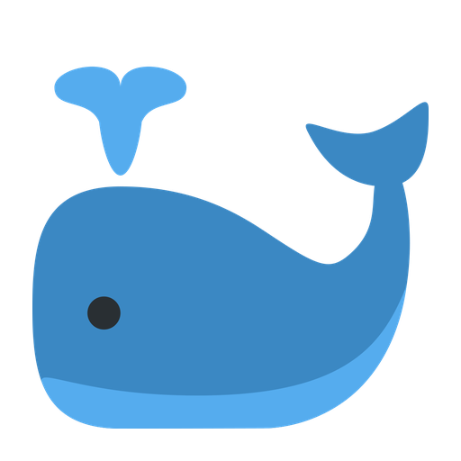

# DSH FishBuddy for macOS

> 桌面上的 AI 伴侣挂件：按住说话、陪你看屏幕、把回话念出来。
> 与 [DeepSeek Harness](https://www.deepseek.com/) 通过本地回环协议通信，所有数据不出本机（在线音色除外）。

[](https://github.com/LosproeOcl/dsh-fishbuddy-mac/actions/workflows/ci.yml)
[](https://github.com/LosproeOcl/dsh-fishbuddy-mac/releases)
[](LICENSE)
[](#requirements)
[](requirements.txt)

<p align="center">
  
  
</p>

---

## Overview

DSH FishBuddy is a native macOS companion widget for DeepSeek Harness. It behaves like a
desktop pet that is also a voice front-end for your agent sessions:

- **Talk to it** — hold the icon (or a global hotkey) and speak; on-device speech recognition
  turns it into text and injects it into your bound session.
- **It talks back** — the last message of a turn is pushed back and shown as a frosted bubble,
  optionally as a scrolling danmaku line, and read aloud by a system or neural voice.
- **It watches with you** — in watch mode it periodically screenshots the screen, OCRs the
  subtitle area, and sends both frames and captured lines as context.
- **Hands-free calling** — phone mode chains listen → recognize → send → wait → speak in a loop.

Everything is local: the widget talks to the plugin over `127.0.0.1:8777/8778`. The only
optional outbound traffic is the `edge-tts` voice (`zh-CN-XiaoxiaoNeural`), which can be
switched off in favour of the on-device synthesizer.

## Features

| Area | Capability | Permission |
|---|---|---|
| Voice input | Hold-to-talk, global hotkeys, VAD-based phone mode | Microphone, Speech Recognition |
| Voice output | System voice (highest quality installed) or Edge neural voice | Network (edge only) |
| Visuals | Three personas (official whale / minimal dot / mascot), 48–320 px size slider | — |
| Reply surface | Frosted-glass bubble, danmaku line (font family + 16–56 px size), edge-triggered TTS | — |
| Watch mode | Periodic screenshots, Vision OCR of the subtitle band, context injection | Screen Recording |
| Automation | Four configurable global hotkeys, per-action conflict detection | Accessibility (optional) |
| Settings | Native settings window, persisted to `~/.dsh/fishbuddy-mac.json` | — |

### Personas

| Official whale | Minimal dot | Mascot |
|---|---|---|
|  |  |  |
| DeepSeek brand mark (trademark of DeepSeek) | Flat dot, no glow | Whale-girl fan art (CC BY-NC-SA 4.0) |

> The mascot art is **not** MIT and **not** for commercial use. See [THIRD-PARTY.md](THIRD-PARTY.md).

## Requirements

- macOS 13 Ventura or later (tested on macOS 26, Apple Silicon)
- Python 3.9+ (CI covers 3.9 and 3.12; developed against 3.14)
- DeepSeek Harness with plugin support
- ~200 MB disk for the virtual environment

## Installation

```sh
git clone https://github.com/LosproeOcl/dsh-fishbuddy-mac.git
cd dsh-fishbuddy-mac

./install.sh                 # creates .venv, installs deps, builds DSH-FishBuddy.app
dsh plugin --profile desktop add ./plugin
open DSH-FishBuddy.app
```

Manual equivalent:

```sh
python3 -m venv .venv
.venv/bin/pip install -r requirements.txt
./build.sh .venv/bin/python
```

> Always launch via `open DSH-FishBuddy.app`. macOS TCC (microphone, speech, screen recording)
> binds permissions to the app bundle identity; running `python main.py` directly cannot obtain them.

## Permissions

| Permission | Used by | Without it |
|---|---|---|
| Microphone | Hold-to-talk, phone mode | Bubble reports that the mic cannot be opened |
| Speech Recognition | All transcription | Bubble asks you to enable it in System Settings |
| Screen Recording | Watch mode, “take a look” | Bubble offers a shortcut to the settings pane |
| Accessibility | Global hotkeys | Hotkeys silently do nothing; the icon still works |

After changing permissions, quit and relaunch the widget.

## Configuration

### Plugin (`~/.dsh/fishbuddy-mac-plugin.json`)

```json
{
  "会话": "session-xxxxxxxx-xxxx-xxxx-xxxx-xxxxxxxxxxxx",
  "回调": "http://127.0.0.1:8778/hands/reply",
  "挂件路径": "/Applications/DSH-FishBuddy.app",
  "端口": 8777
}
```

The same values are editable in **DSH → Settings → 大肥鱼**, which additionally offers
*Launch widget*, *Open widget settings*, *Show* and *Hide*.

### Widget (`~/.dsh/fishbuddy-mac.json`)

| Key | Default | Meaning |
|---|---|---|
| `挂件` | `true` | Show the icon (menu bar item always present) |
| `形象` | `image` | `image` / `minimal` / `mascot` |
| `尺寸` | `132` | Icon edge length in px (48–320) |
| `朗读` | `true` | Speak replies aloud |
| `音色` | `system` | `system` or `edge` (neural, online) |
| `麦克风` | `null` | Input device index; `null` = system default |
| `弹幕` | `true` | Show replies as danmaku |
| `弹幕字号` | `30` | Danmaku font size (16–56 px) |
| `弹幕字体` | `""` | Font family; empty = system bold |
| `电话模式` | `false` | Hands-free conversation loop |
| `断句秒` | `1.3` | Silence before an utterance is considered finished |
| `识别提示` | `""` | Comma-separated contextual words for the recognizer |
| `热键表` | see below | Per-action key bindings |

Default hotkeys: `⌥Space` talk, `⌥P` watch toggle, `⌥L` look now, `⌥S` settings.
Bindings are validated: modifier required, system shortcuts and duplicate bindings rejected.

## Architecture

```
┌────────────────────────────┐        HTTP (loopback)        ┌──────────────────────────┐
│  DSH-FishBuddy.app         │                               │  DSH plugin              │
│  (PyObjC, accessory app)   │  POST 8777/hands/say          │  dsh-fishbuddy-mac       │
│                            │  POST 8777/hands/frame   ───► │                          │
│  • NSWindow overlay        │  POST 8777/hands/subtitle     │  • session delivery      │
│  • SFSpeechRecognizer      │  GET  8777/hands/ping         │  • reply capture         │
│  • AVSpeechSynthesizer     │                               │  • settings page         │
│  • Vision OCR              │  POST 8778/hands/reply   ◄─── │  • widget controls       │
│  • sounddevice + numpy     │  POST 8778/settings|show|hide │                          │
└────────────────────────────┘                               └──────────────────────────┘
                                                                    │
                                                                    ▼
                                                            DSH session controller
```

- The widget owns audio capture, recognition, rendering and OS integrations.
- The plugin owns session binding, message delivery, reply capture (filtering out reasoning
  segments) and the settings UI.

## Protocol

| Direction | Endpoint | Payload |
|---|---|---|
| widget → plugin | `POST /hands/say` | `{"text": "…"}` |
| widget → plugin | `POST /hands/frame` | `{"图片": "<base64>", "存档": 0\|1, "立即": 0\|1, "来源": "陪看"}` |
| widget → plugin | `POST /hands/subtitle` | `{"lines": ["…"]}` |
| widget → plugin | `GET /hands/ping` | — |
| plugin → widget | `POST /hands/reply` | `{"text": "…", "session": "session-…"}` |
| plugin → widget | `POST /settings` · `/show` · `/hide` | — |
| plugin → widget | `GET /state` | version, persona, mic status, watching |

The plugin prefixes the most recent 30 s of captured subtitles to outgoing utterances, so the
agent knows what is happening on screen without extra turns.

## Development

```sh
python3 -m venv .venv
.venv/bin/pip install -r requirements-dev.txt

.venv/bin/ruff check .          # lint
.venv/bin/python -m pytest -q   # smoke tests
./build.sh .venv/bin/python     # build the .app
python tools/make_assets.py     # regenerate assets (needs cairosvg)
```

Layout:

```
main.py                 widget: windows, audio, ASR, OCR, TTS, danmaku, settings, server
plugin/                 DSH plugin: session bridge, settings UI, diagnostics
tools/make_assets.py    asset generation (whale from Twemoji SVG, dot)
tests/                  smoke tests
.github/workflows/      CI (ruff + pytest + build) and Release (zip + sha256)
```

Debug switches (read from the environment; use `launchctl setenv` before `open`):

| Variable | Effect |
|---|---|
| `FISH_TEST_SHOT=1` | Capture a screenshot at startup to verify Screen Recording |
| `FISH_TEST_MIC=1` | Record 1.5 s at startup and report frame count |
| `FISH_TEST_WAV=/p.wav` | Transcribe a file and log the result |
| `FISH_TEST_SETTINGS=1` | Open the settings window at startup |
| `FISH_TEST_MODE=minimal` | Force a persona without persisting it |
| `FISH_TEST_REC=1` | Run one main-thread recording cycle |

## Release

1. Update `VERSION` in `main.py`, add a `CHANGELOG.md` entry.
2. `git tag v0.x.y && git push origin v0.x.y`
3. The release workflow validates tag ↔ version, runs tests, builds a zip with a SHA-256
   checksum, and publishes a GitHub Release.

## Troubleshooting

| Symptom | Cause | Fix |
|---|---|---|
| `No speech detected` | Input level too low (Bluetooth headset) | Pick another microphone in settings, or move closer |
| Recognition drifts | Proper nouns unknown to the model | Add them under *识别提示* |
| Screenshots are black | Screen Recording denied | Toggle the permission, relaunch |
| Hotkeys do nothing | Accessibility denied | Enable it for “大肥鱼”, relaunch |
| Widget invisible | Hidden via plugin, or on another Space | Right-click the menu bar icon → Settings → show; the window now joins all Spaces |
| Plugin responses stale | DSH caches plugin modules | The entry uses a cache-busting dynamic import; re-enable the plugin |

## License

Code (widget and plugin) is [MIT](LICENSE).

Artwork is **not** MIT: the official whale belongs to DeepSeek (trademark, unofficial project);
the mascot is CC BY-NC-SA 4.0 (non-commercial). Details in [THIRD-PARTY.md](THIRD-PARTY.md).
Replace `assets/whale.png` / `assets/mascot.png` to redistribute under your own terms.
